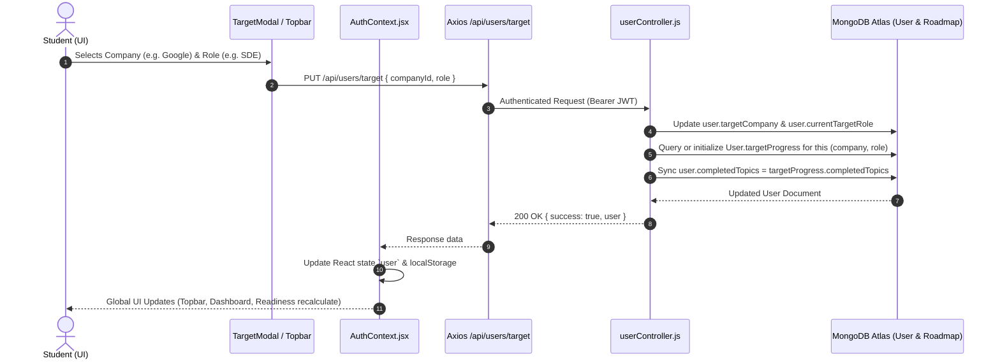
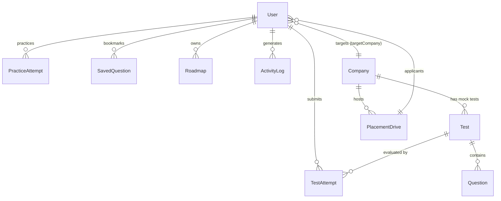

# HireVerse — Complete Project Audit & Technical Architecture Documentation

**Document Version:** 1.0.0  
**Audit Date:** October 2026  
**Audited Codebase:** HireVerse (Placement Preparation & Interview Readiness Platform)  
**Repository Working Directory:** `d:\PlacementPreparationTracker`  
**Classification:** Internal Technical Architecture & System Specification

---

## 1. Executive Project Overview

### 1.1 What HireVerse Does
**HireVerse** is a full-stack, company-centric placement preparation and campus recruitment readiness platform designed for engineering and computer science students preparing for on-campus and off-campus placements. Unlike generic coding platforms (e.g., LeetCode, HackerRank) that categorize content strictly by data structures and algorithms, HireVerse organizes preparation around **specific target companies** (e.g., Google, Amazon, TCS, Infosys, Accenture, Wipro) and **specific job roles** (e.g., Software Development Engineer, Full Stack Engineer, Graduate Trainee, Data Analyst).

The platform tracks student learning progress, provides company-tailored roadmaps, offers timed mock examinations matching actual company test patterns (aptitude, technical MCQs, coding, and verbal reasoning), computes a multi-pillar **Readiness Score**, logs campus placement drives, and delivers administrative tools for campus Training & Placement Officers (TPOs) and faculty admins.

### 1.2 Core Problem Solved
Traditional placement preparation suffers from three major inefficiencies:
1. **Context Switching & Fragmentation:** Students solve random problems across multiple platforms without knowing whether those specific problem archetypes align with the hiring patterns of their target company.
2. **Ambiguous Readiness:** Students rely on subjective intuition ("I solved 100 problems, so I might be ready") rather than an empirical, data-backed metric derived from test accuracy, syllabus coverage, and timing.
3. **Campus Placement Disconnection:** Training preparation is disconnected from actual campus recruitment drives, company deadlines, eligibility criteria, and application management.

HireVerse unifies target selection, customized curriculum roadmaps, company-pattern mock assessments, deterministic readiness analytics, and placement drive tracking into a single cohesive system.

### 1.3 Implementation Status Overview
The codebase was inspected line-by-line across all frontend pages, components, backend controllers, models, and service pipelines. The features are categorized below into **Working (Production-Grade)**, **Partially Implemented**, **Simulated (Client-Side Only)**, and **UI Placeholders / Missing**:

| Category | Feature | Implementation Reality | Notes |
| :--- | :--- | :--- | :--- |
| **Fully Implemented** | JWT Authentication & Sessions | Working (Backend + Frontend) | Passwords hashed with `bcryptjs` (10 rounds), JWT signed (7-day validity), Axios auth interceptors with auto 401 logout, protected route guards. |
| **Fully Implemented** | Target Company & Role Scoping | Working (Full Stack) | `User.targetCompany` (ref `Company`) & `User.currentTargetRole`. Full target isolation across roadmap, mock test history, and curriculum topic completion (`User.targetProgress`). |
| **Fully Implemented** | First-Time User Onboarding | Working (`/onboarding`) | Modal and dedicated onboarding page for selecting target company, target role, graduation year, and degree. Automatically bypassed if target is already configured. |
| **Fully Implemented** | Company Guide & Details | Working (`/companies`, `/companies/:id`) | Displays rounds, CTC packages, criteria, hiring patterns, target selection trigger, and curriculum navigation. |
| **Fully Implemented** | Company Preparation Hub | Working (`/companies/:id/curriculum`) | Module-based syllabus, topic completion checkboxes, real-time backend persistence via `/api/users/progress/topic`. Automatically isolated to selected target. |
| **Fully Implemented** | Dynamic Interactive Roadmap | Working (`/roadmap`) | Phase-by-phase curriculum generated by `roadmapService.js` and stored in `Roadmap` collection. Isolated by `{ user, company, role }`. Milestone completion updates dynamically. |
| **Fully Implemented** | Mock Assessment Engine | Working (`/mock-tests`, `/mock-tests/exam/:id`, `/mock-tests/result/:id`) | Timed tests, anti-cheat detection (window blur & tab switch count), answer persistence, automated scoring engine (`testEvaluationService.js`), section-wise breakdown, pass/fail evaluation. |
| **Fully Implemented** | Deterministic Readiness Score | Working (`/readiness`) | 4-pillar algorithmic score calculated on-the-fly by `readinessService.js` (Practice 35%, Mock Tests 30%, Topic/Roadmap Progress 20%, Syllabus Coverage 15%). Includes sufficiency thresholds and personalized weakness diagnostics. |
| **Fully Implemented** | Performance Analytics | Working (`/analytics`) | Dynamic metrics, radar/bar subject strength charts, score distribution, weak area identification, and recent test attempt timeline. |
| **Fully Implemented** | Practice Question Bank | Working (`/practice`) | Filterable by category (DSA, Aptitude, Core Subjects), difficulty, search query, with instant answer checking and attempt logging to `PracticeAttempt`. |
| **Fully Implemented** | Campus Placement Drives | Working (`/placement-drives`) | Student-facing view of active campus recruitment drives, minimum CGPA/backlog eligibility enforcement, and application submission to `PlacementDrive.applicants`. |
| **Fully Implemented** | Placement Officer Portal | Working (`/placement-portal`) | TPO/Coordinator interface to create, update, and close campus drives, view student applicants, and track selection rounds. |
| **Fully Implemented** | Admin Management Console | Working (`/admin`) | Restricted to `admin` / `tpo` roles. System-wide user metrics, Question Bank management (CRUD), Assessment creation, and drive oversight. |
| **Partially Implemented** | Password Reset Flow | Backend Only | `authController.forgotPassword` generates crypto token and returns token in JSON response. No SMTP email delivery is configured (`sendEmail` is absent); frontend UI input exists on `/login`. |
| **Simulated (Client-Only)** | AI Resume Analyzer | Frontend Mockup (`/resume-analyzer`) | Pure client-side state machine. Accepts file upload, uses a local `setTimeout(900ms)` simulation, and returns static keyword matches (84/100 score). No backend API or LLM call. |
| **Simulated (Client-Only)** | AI Mock Interview | Frontend Mockup (`/ai-interview`) | Client-side question stepper with hardcoded questions for Accenture/Google/TCS. Web Speech / Audio recorder button is a visual placeholder; feedback is generated via static `setTimeout(1200ms)`. |
| **Missing / Not Implemented** | Email OTP Verification | Not Implemented | Registration directly activates account and returns JWT. No OTP generation, storage, or verification routes exist in the backend despite conceptual prompts mentioning OTP. |
| **Missing / Not Implemented** | Coding Sandbox Execution | Not Implemented | Coding questions in Mock Assessments accept code submissions as text strings; there is no remote Docker/sandbox code execution engine (e.g., Judge0 or Piston). |

### 1.4 High-Level System Architecture

```mermaid
flowchart TD
    subgraph Client["Frontend Client (React 18 + Vite :5173)"]
        UI["UI Layer (TailwindCSS + Lucide Icons)"]
        Router["React Router v6 (/dashboard, /mock-tests, /roadmap, etc.)"]
        AuthCtx["AuthContext (User, Token, Target Company/Role)"]
        Axios["Axios Client (Base URL: /api with Auth Interceptor)"]
    end

    subgraph ReverseProxy["Vite Dev Server Proxy"]
        Proxy["Proxy: /api -> http://localhost:5000/api"]
    end

    subgraph Backend["Backend Server (Express.js :5000)"]
        App["Express App (CORS, Helmet, RateLimiter, JSON)"]
        Middl["Middleware Pipeline (authMiddleware, roleMiddleware, validateRequest)"]
        
        subgraph Controllers["Express Controllers"]
            AuthC["authController"]
            CompC["companyController"]
            TestC["testController"]
            ReadC["readinessController"]
            RoadC["roadmapController"]
            UserC["userController"]
            DriveC["driveController"]
            AdminC["adminController"]
        end

        subgraph Services["Domain Services"]
            ReadSvc["readinessService.js"]
            RoadSvc["roadmapService.js"]
            CurricSvc["curriculumService.js"]
            EvalSvc["testEvaluationService.js"]
        end
    end

    subgraph Database["Database (MongoDB Atlas)"]
        Atlas[("MongoDB Atlas Cloud Database (hireverse)")]
        Models["12 Mongoose Models (User, Company, Test, TestAttempt, Roadmap, etc.)"]
    end

    UI --> Router
    Router --> AuthCtx
    AuthCtx --> Axios
    Axios --> Proxy
    Proxy --> App
    App --> Middl
    Middl --> Controllers
    Controllers --> Services
    Controllers --> Models
    Services --> Models
    Models --> Atlas
```



---

## 2. Directory Structure & File Inventory

### 2.1 Workspace Root Structure
```
PlacementPreparationTracker/
├── .env.example                  # Environment variable reference template
├── .gitignore                    # Git ignore file for node_modules, dist, .env
├── HIREVERSE_PROJECT_DOCUMENTATION.md # Comprehensive Technical Documentation (This Document)
├── index.html                    # Single-Page Application HTML entry point
├── package.json                  # Root npm package definition (scripts & frontend dependencies)
├── package-lock.json             # Root dependency lockfile
├── postcss.config.js             # PostCSS plugins (TailwindCSS, Autoprefixer)
├── tailwind.config.js            # Tailwind styling tokens, colors, breakpoints
├── vite.config.js                # Vite build config with port 5173 & /api reverse proxy
├── public/                       # Static public assets (favicons, SVGs)
├── src/                          # Frontend source code
└── server/                       # Backend source code and server package
```

### 2.2 Frontend Directory Tree (`src/`)
```
src/
├── App.jsx                       # Master React Router configuration & route declarations
├── main.jsx                      # React 18 DOM mount point (ReactDOM.createRoot)
├── index.css                     # Global styles, Tailwind directives, custom scrollbars
├── data.js                       # Legacy/mockup data file (Orphaned - 0 active imports)
│
├── api/
│   └── client.js                 # Central Axios instance, response interceptors, & API namespaces
│
├── components/
│   ├── auth/
│   │   ├── ProtectedRoute.jsx    # Authentication & role guard wrapper component
│   │   └── PublicRoute.jsx       # Redirects authenticated users away from /login
│   ├── common/
│   │   ├── Badge.jsx             # Status and tag badge UI component
│   │   ├── Button.jsx            # Reusable button with variants (primary, secondary, danger)
│   │   ├── Card.jsx              # Elevated container card component
│   │   ├── Modal.jsx             # Reusable accessible dialog modal
│   │   ├── ProgressBar.jsx       # Visual percentage progress indicator
│   │   ├── StatCard.jsx          # Metric display card with icon and trend
│   │   └── TabNav.jsx            # Tab switching navigation bar
│   ├── layout/
│   │   ├── AppLayout.jsx         # Primary authenticated layout (Sidebar + Topbar + Outlet)
│   │   ├── Navbar.jsx            # Unauthenticated public landing page navbar
│   │   ├── Sidebar.jsx           # Authenticated navigation drawer (links, badges, active states)
│   │   └── Topbar.jsx            # Header with target company selector, quick links, & user avatar
│   └── modals/
│       └── TargetModal.jsx       # Dynamic target company & role selection modal
│
├── context/
│   └── AuthContext.jsx           # Global authentication context, JWT storage, target state sync
│
├── hooks/
│   └── useAuth.js                # Convenience hook exporting useContext(AuthContext)
│
├── pages/
│   ├── LandingPage.jsx           # Public SaaS homepage (Hero, Features, Pricing, Testimonials)
│   ├── AuthPage.jsx              # Tabbed Login, Registration, and Forgot Password views
│   ├── OnboardingPage.jsx        # First-time target company and role setup wizard
│   ├── DashboardPage.jsx         # Student home hub (Readiness card, Target stats, Quick links)
│   ├── CompaniesPage.jsx         # Grid of recruit partner companies with search & filters
│   ├── CompanyGuidePage.jsx      # Deep-dive on company rounds, packages, criteria, & target switch
│   ├── CompanyLearningPage.jsx   # Interactive syllabus topic checklist per company
│   ├── MockTestsPage.jsx         # Available assessment list, duration, difficulty, & history
│   ├── MockExamPage.jsx          # Live timed test runner with anti-cheat & section stepper
│   ├── MockResultPage.jsx        # Assessment report card with answer review & recommendations
│   ├── RoadmapPage.jsx           # Phase-based visual milestone roadmap for current target
│   ├── ReadinessPage.jsx         # Diagnostic scoring dashboard with 4-pillar breakdown
│   ├── AnalyticsPage.jsx         # Subject accuracy radar, trend charts, weak area alerts
│   ├── PracticePage.jsx          # Self-paced question bank with filters & answer feedback
│   ├── PlacementDrivesPage.jsx   # Student campus drive bulletin & application tracker
│   ├── PlacementPortalPage.jsx   # TPO management console for posting and tracking campus drives
│   ├── AdminPage.jsx             # Admin control panel (user stats, question builder, test builder)
│   ├── ResumeAnalyzerPage.jsx    # Simulated AI Resume scanner and keyword matcher
│   └── AiInterviewPage.jsx       # Simulated AI Video/Audio mock interview interface
│
└── utils/
    ├── formatters.js             # Date, score, duration, and currency formatting helpers
    └── helpers.js                # Array manipulation, debounce, and query parameter utilities
```

### 2.3 Backend Directory Tree (`server/`)
```
server/
├── .env                          # Backend environment variables (PORT, MONGO_URI, JWT_SECRET)
├── package.json                  # Backend dependencies, engine specs, & npm scripts
├── package-lock.json             # Backend lockfile
│
└── src/
    ├── server.js                 # Server process entry point (starts HTTP listener on PORT 5000)
    ├── app.js                    # Express application builder (middleware, CORS, routes)
    │
    ├── config/
    │   ├── db.js                 # Mongoose connection manager with reconnection logic
    │   └── env.js                # Centralized environment variable validator & exporter
    │
    ├── constants/
    │   └── index.js              # Enums for Roles, Test Types, Question Categories, Statuses
    │
    ├── controllers/
    │   ├── activityController.js # Logs and retrieves student prep activities
    │   ├── adminController.js    # Admin analytics, user listing, content moderation
    │   ├── authController.js     # Signup, login, password reset, current user profile
    │   ├── companyController.js  # Company CRUD, recruitment patterns, and curriculum guides
    │   ├── driveController.js    # Campus placement drive posting, applications, and status
    │   ├── questionController.js # Question bank queries, categorization, and validation
    │   ├── readinessController.js# Aggregates 4-pillar readiness calculation
    │   ├── roadmapController.js  # Generates and persists company/role roadmap milestones
    │   ├── testController.js     # Mock test queries, live attempt submissions, evaluation
    │   └── userController.js     # Target setting, topic progress updates, bookmarking
    │
    ├── middleware/
    │   ├── authMiddleware.js     # Verifies Bearer JWT tokens and populates req.user
    │   ├── roleMiddleware.js     # Validates user role permissions (student, tpo, admin)
    │   ├── validateRequest.js    # Request body and query parameter validation wrapper
    │   ├── rateLimiter.js        # Express rate limiting to prevent brute force attacks
    │   └── errorHandler.js       # Global Express error handler returning uniform JSON errors
    │
    ├── models/
    │   ├── ActivityLog.js        # Audit trail of student actions (test started, topic checked)
    │   ├── Announcement.js       # Campus and platform-wide notification broadcasts
    │   ├── Company.js            # Target company profiles, hiring patterns, and requirements
    │   ├── JobRole.js            # Job role definitions, required skills, and salary bands
    │   ├── PlacementDrive.js     # Campus recruitment drive postings and applicant records
    │   ├── PracticeAttempt.js    # Log of individual practice questions answered by students
    │   ├── Question.js           # Central Question Bank (MCQs, coding stubs, aptitude)
    │   ├── Roadmap.js            # Multi-phase milestone roadmaps tailored to company & role
    │   ├── SavedQuestion.js      # Student bookmarked questions for revision
    │   ├── Test.js               # Structured mock tests with question lists, cutoffs, timer
    │   ├── TestAttempt.js        # Detailed record of student test attempts, scores, and integrity
    │   └── User.js               # User accounts, credentials, target selections, and progress
    │
    ├── routes/
    │   ├── activityRoutes.js     # /api/activity
    │   ├── adminRoutes.js        # /api/admin
    │   ├── authRoutes.js         # /api/auth
    │   ├── companyRoutes.js      # /api/companies
    │   ├── driveRoutes.js        # /api/drives
    │   ├── index.js              # Master router mounting all sub-routes to /api
    │   ├── questionRoutes.js     # /api/questions
    │   ├── readinessRoutes.js    # /api/readiness
    │   ├── roadmapRoutes.js      # /api/roadmap
    │   ├── testRoutes.js         # /api/tests
    │   └── userRoutes.js         # /api/users
    │
    ├── services/
    │   ├── curriculumService.js  # Dynamic company syllabus topic extraction & completion logic
    │   ├── readinessService.js   # Algorithmic calculation of student placement readiness
    │   ├── roadmapService.js     # Rule-based generator for phased learning roadmaps
    │   └── testEvaluationService.js # Scores test submissions, computes section % and pass/fail
    │
    ├── utils/
    │   ├── apiResponse.js        # Standardized JSON response formatting helper
    │   └── seedData.js           # Database seeder for default companies, questions, and tests
    │
    └── scripts/
        ├── seed.js               # Executable CLI database seeder script
        └── verifyConnection.js   # Diagnostic script testing MongoDB Atlas connectivity
```

---

## 3. Technology Stack & Dependencies

### 3.1 Frontend Dependencies (`package.json`)
- **Core Framework:** React `18.2.0`
- **DOM Rendering Engine:** React DOM `18.2.0`
- **Client Routing:** `react-router-dom` `6.22.3`
- **HTTP Client:** `axios` `1.6.8`
- **Iconography:** `lucide-react` `0.359.0`
- **Styling Utility:** `clsx` `2.1.0`, `tailwind-merge` `2.2.2`
- **Build Tool:** `vite` `5.1.6`
- **CSS Preprocessing:** `tailwindcss` `3.4.1`, `postcss` `8.4.35`, `autoprefixer` `10.4.18`
- **Linting:** ESLint `8.57.0` with `@vitejs/plugin-react` `4.2.1`

### 3.2 Backend Dependencies (`server/package.json`)
- **Runtime Environment:** Node.js (Recommended `v18.x` or `v20.x` LTS)
- **Application Framework:** Express.js `4.19.2`
- **Object Data Modeling (ODM):** Mongoose `8.13.0`
- **Security & Headers:** `helmet` `7.1.0`, `cors` `2.8.5`
- **Rate Limiting:** `express-rate-limit` `7.2.0`
- **Authentication & Security:** `jsonwebtoken` `9.0.2`, `bcryptjs` `2.4.3`
- **Environment Configuration:** `dotenv` `16.4.5`
- **Input Sanitization:** `express-validator` `7.0.1`, `xss-clean` `0.1.4`, `express-mongo-sanitize` `2.2.0`
- **Development Tooling:** `nodemon` `3.1.0`
- **Testing & Verification:** `mocha` `10.4.0`, `chai` `4.4.1`, `supertest` `6.3.4`, `mongodb-memory-server` `9.2.0`

---

## 4. Frontend Route Inventory & Access Matrix

All application routes are defined in `src/App.jsx`. The platform utilizes route-level access control via `ProtectedRoute` and `PublicRoute`:

| URL Route | Page Component | Access Level | Layout Wrapper | Functional Purpose |
| :--- | :--- | :--- | :--- | :--- |
| `/` | `LandingPage.jsx` | Public | None (Own Navbar/Footer) | Enterprise SaaS presentation, marketing, feature highlights. |
| `/login` | `AuthPage.jsx` | PublicOnly (`PublicRoute`) | None | Student/Faculty authentication (Login, Register, Forgot Password). |
| `/onboarding` | `OnboardingPage.jsx` | Protected | None (Fullscreen Wizard) | Initial target company and job role selection after first signup. |
| `/dashboard` | `DashboardPage.jsx` | Protected | `AppLayout` (Sidebar + Topbar) | Primary command center: target summary, readiness gauge, next actions. |
| `/companies` | `CompaniesPage.jsx` | Protected | `AppLayout` | Searchable directory of recruit companies with eligibility filters. |
| `/companies/:id` | `CompanyGuidePage.jsx`| Protected | `AppLayout` | In-depth hiring guide for selected company: packages, rounds, target setting. |
| `/companies/:id/curriculum`| `CompanyLearningPage.jsx`| Protected | `AppLayout` | Checklist of required syllabus topics for target company with live tracking. |
| `/roadmap` | `RoadmapPage.jsx` | Protected | `AppLayout` | Dynamic milestone progression generated specifically for student's target. |
| `/mock-tests` | `MockTestsPage.jsx` | Protected | `AppLayout` | Mock assessment catalog (company-specific patterns, past attempts). |
| `/mock-tests/exam/:id` | `MockExamPage.jsx` | Protected | None (Distraction-Free) | Timed live exam runner with anti-cheat detection and section tabs. |
| `/mock-tests/result/:id`| `MockResultPage.jsx`| Protected | `AppLayout` | Post-test score report, question review, explanations, and time metrics. |
| `/readiness` | `ReadinessPage.jsx` | Protected | `AppLayout` | 4-pillar readiness dashboard with diagnostic recommendations. |
| `/analytics` | `AnalyticsPage.jsx` | Protected | `AppLayout` | Performance charts, subject accuracy breakdown, and practice history. |
| `/practice` | `PracticePage.jsx` | Protected | `AppLayout` | Self-paced question bank filtered by category, difficulty, and company. |
| `/placement-drives`| `PlacementDrivesPage.jsx`| Protected | `AppLayout` | Campus recruitment drive bulletin with student application submission. |
| `/placement-portal`| `PlacementPortalPage.jsx`| Protected (TPO/Admin) | `AppLayout` | Campus recruitment management: create drives, review student applicants. |
| `/admin` | `AdminPage.jsx` | Protected (Admin Only) | `AppLayout` | System management: question bank editor, test authoring, user directory. |
| `/resume-analyzer`| `ResumeAnalyzerPage.jsx`| Protected | `AppLayout` | Simulated AI ATS resume scoring against target company keywords. |
| `/ai-interview` | `AiInterviewPage.jsx` | Protected | `AppLayout` | Simulated AI mock technical interview with question stepper and timer. |
| `*` | Redirect | Wildcard | N/A | Redirects unknown routes to `/dashboard` (or `/login` if unauthenticated). |

---

## 5. Authentication, Authorization & User Lifecycle

### 5.1 Registration Flow
1. The student submits `name`, `email`, `password`, `college`, `degree`, and `graduationYear` to `POST /api/auth/register`.
2. `authController.register` checks if the email already exists in MongoDB.
3. The password is encrypted using `bcrypt.hash(password, 10)`.
4. The user is saved to MongoDB with default role `student`, empty `completedTopics: []`, and empty `targetProgress: []`.
5. A signed JSON Web Token (JWT) is generated containing `{ id: user._id, role: user.role }` with a 7-day expiration.
6. The backend returns `{ success: true, token, user }`.
7. `AuthContext.jsx` stores the token and user object in `localStorage` under keys `hireverse_token` and `hireverse_user`.
8. Axios immediately attaches `Authorization: Bearer <token>` to all subsequent HTTP requests via its request interceptor.
9. If `user.targetCompany` is undefined, the frontend automatically routes the student to `/onboarding`.

> **Architectural Audit Note regarding OTP Verification:**  
> The codebase contains **no active OTP (One-Time Password) generation or verification logic**. Accounts are immediately verified and activated upon initial registration. No SMS or email OTP endpoints exist in `authRoutes.js`.

### 5.2 Login & Session Management
1. The user posts credentials to `POST /api/auth/login`.
2. The user is looked up by email with `.select('+password')`.
3. `user.matchPassword(password)` executes `bcrypt.compare`.
4. The last login timestamp (`lastLogin`) is updated.
5. A fresh JWT is returned and stored in `localStorage`.
6. If the user's token expires or becomes invalid, the Axios response interceptor (`src/api/client.js`) catches the HTTP 401 error, removes `hireverse_token` and `hireverse_user` from `localStorage`, and forces a window redirect to `/login`.

### 5.3 Password Reset Mechanism
- Endpoint: `POST /api/auth/forgot-password`
- Process: The backend generates a 20-byte cryptographically secure random token (`crypto.randomBytes(20).toString('hex')`), hashes it via SHA-256, and stores it in `user.resetPasswordToken` with an expiry of 10 minutes (`user.resetPasswordExpire = Date.now() + 10 * 60 * 1000`).
- Current Limitation: In the current development build, the reset token is returned directly in the API response JSON for development testing because an external SMTP mailing provider (e.g., SendGrid, Nodemailer) is not yet configured.

### 5.4 Role-Based Access Control (RBAC)
Role authorization is enforced on the backend via `server/src/middleware/roleMiddleware.js`:
- `student`: Standard access to preparation hub, mock tests, roadmaps, readiness, practice, and drive applications.
- `tpo` (Training & Placement Officer): Access to `/placement-portal` to manage company drives, schedule recruitment dates, and view applicant lists.
- `admin`: Superuser access to `/admin`, question creation, mock test authoring, and platform-wide statistics.

Frontend enforcement is managed by `ProtectedRoute.jsx` via the `requiredRole` prop. If an unauthorized student attempts to load `/admin` or `/placement-portal`, the component redirects them back to `/dashboard`.

---

## 6. Target Company & Job Role Lifecycle

A core strength of the HireVerse platform is target isolation: when a student changes their target company or job role, their curriculum, roadmap, and test history adapt dynamically.



### 6.1 State Synchronization Logic
1. **Selection Entry Points:** Students can change their target via:
   - The `/onboarding` onboarding screen upon registration.
   - The `TargetModal.jsx` modal accessible at any time from the Topbar.
   - The "Set as My Target Company" button on `CompanyGuidePage.jsx` (`/companies/:id`).
2. **Backend Persistence:** Handled by `PUT /api/users/target` in `server/src/controllers/userController.js`.
3. **Data Isolation Across Targets (`User.targetProgress`):**
   ```javascript
   // Inside User schema
   targetProgress: [{
     company: { type: mongoose.Schema.Types.ObjectId, ref: 'Company' },
     role: { type: String, default: 'General' },
     completedTopics: [{ type: String }]
   }]
   ```
   When switching from *TCS* to *Google*, the student's completed curriculum topics for TCS are preserved in `targetProgress`. The active `User.completedTopics` array is re-hydrated with Google's completed topics, ensuring that switching targets never wipes previous progress.
4. **Roadmap Scoping:** The `Roadmap` collection enforces a compound unique index on `{ user: 1, company: 1, role: 1 }`. When a student selects a new target, the system loads or generates a roadmap dedicated exclusively to that company and role.

---

## 7. Deep-Dive Feature Audits

### 7.1 Dashboard (`/dashboard`)
- **State & Data Loading:** On mount, `DashboardPage.jsx` fires parallel requests to `api.users.getProfile()`, `api.readiness.getScore()`, `api.companies.getAll()`, `api.tests.getAttempts()`, and `api.activity.getRecent()`.
- **Target Company Banner:** Displays the currently targeted company logo, name, role, and a direct link to the Company Guide and Preparation Hub.
- **Readiness Gauge:** Renders the circular score computed by `readinessService.js`, displaying the categorical readiness label (`High`, `Moderate`, `Needs Focus`).
- **Quick Actions:** One-click shortcuts to continue the targeted roadmap, launch a mock assessment, open the curriculum checklist, or view active placement drives.

### 7.2 Company Directory & Guide (`/companies`, `/companies/:id`)
- **Directory (`/companies`):** Fetches all companies via `GET /api/companies`. Supports search by company name, category filtering (Product, Service, Consulting), and minimum package filtering.
- **Guide Page (`/companies/:id`):** Displays recruitment patterns, selection rounds (Online Assessment, Technical Interview 1, Technical Interview 2, HR Round), required skills, eligibility criteria (minimum CGPA, allowed backlogs), and recent placement history.
- **Target Activation:** Contains the action button `Set as Target Company` which invokes `api.users.setTarget(company._id, selectedRole)`.

### 7.3 Company Preparation Hub & Curriculum (`/companies/:id/curriculum`)
- **Curriculum Architecture:** Powered by `curriculumService.js`. Breaks preparation down into structured modules:
  1. *Aptitude & Logical Reasoning* (Quantitative, Logical, Verbal)
  2. *Core Computer Science* (DBMS, Operating Systems, Computer Networks, OOP)
  3. *Data Structures & Algorithms* (Arrays, Trees, Graphs, Dynamic Programming)
  4. *Company-Specific Technical Topics* (System Design, Cloud, Java/C++ Stacks)
- **Real-Time Checkbox Synchronization:** When a student marks a topic as completed, the frontend triggers `PUT /api/users/progress/topic` with `{ topicId, completed: true/false }`. The backend updates both the active `User.completedTopics` and the persistent `User.targetProgress` record for that specific target.

### 7.4 Dynamic Roadmap Engine (`/roadmap`)
- **Generation Logic:** When `/roadmap` is accessed, `GET /api/roadmap` queries the `Roadmap` collection for `{ user: req.user._id, company: targetCompanyId, role: currentTargetRole }`.
- **Automated Seeding:** If no roadmap exists for this combination, `roadmapService.generateRoadmap()` automatically creates a 4-phase structured curriculum:
  - **Phase 1: Foundations & Core CS** (Aptitude, OOP, SQL, OS)
  - **Phase 2: Data Structures & Algorithms** (Core DSA archetypes)
  - **Phase 3: Company-Specific Focus** (Target company previous year topics & coding patterns)
  - **Phase 4: Full-Length Mocks & Revision** (Timed assessments & interview rehearsal)
- **Milestone Completion:** Each phase contains actionable milestone tasks with progress percentages dynamically calculated based on completed items.

### 7.5 Mock Assessment Engine (`/mock-tests`, `/mock-tests/exam/:id`, `/mock-tests/result/:id`)
- **Assessment Catalog (`/mock-tests`):** Categorized into *Company Mock Tests* (matching the active target), *Subject-Wise Tests* (Aptitude, DSA, Core CS), and *Past Attempts History*.
- **Live Exam Runner (`/mock-tests/exam/:id`):**
  - **Timer & Auto-Submit:** Runs a decrementing countdown clock. When the timer reaches `00:00`, the exam triggers an automated emergency submission.
  - **Section Stepper:** Supports multi-section tests (e.g., Section A: Quant, Section B: Technical, Section C: Coding).
  - **Anti-Cheat Monitoring:** Hooks into browser `visibilitychange` and window `blur` events. Detects tab switches and displays warning toasts. The backend `TestAttempt` model persists `tabSwitchesCount` to flag suspicious attempts.
  - **Answer Submission:** Dispatches answers to `POST /api/tests/:id/submit`.
- **Evaluation Engine (`testEvaluationService.js`):**
  - Calculates total marks, marks obtained, percentage score, accuracy, and section-by-section breakdown.
  - Compares total score against `test.cutoffMarks` to assign `passed: true/false`.
- **Report Card (`/mock-tests/result/:id`):** Displays a comprehensive diagnostic breakdown: percentage, accuracy, time taken, question-by-question review with correct answers, and detailed text explanations.

### 7.6 Algorithmic Readiness Score Engine (`/readiness`)
The platform’s Readiness Score is computed on-the-fly by `server/src/services/readinessService.js`. It does not rely on arbitrary mock data; it executes a deterministic 4-pillar calculation:

$$\text{Readiness Score} = (0.35 \times \text{Practice Accuracy}) + (0.30 \times \text{Mock Test Average}) + (0.20 \times \text{Roadmap \& Topic Progress}) + (0.15 \times \text{Syllabus Coverage})$$

#### Weighting Breakdown
1. **Practice Accuracy (35% Weight):** Calculated from all records in `PracticeAttempt` for the student: $\frac{\text{Correct Practice Submissions}}{\text{Total Practice Submissions}} \times 100$.
2. **Mock Test Average (30% Weight):** Mean score percentage across all submitted tests in `TestAttempt`: $\frac{\sum \text{Attempt Percentages}}{N}$.
3. **Roadmap & Topic Progress (20% Weight):** The percentage of completed syllabus topics and roadmap milestones for the active target company.
4. **Syllabus Coverage (15% Weight):** Breadth of topics attempted across distinct subject categories (Aptitude, DSA, DBMS, OS, Networks).

#### Data Sufficiency Guardrails
To prevent misleading 100% scores for new accounts that answer a single question correctly, the service enforces minimum data thresholds:
- Returns `hasEnoughData: false` if the student has completed fewer than 2 practice questions, fewer than 1 mock test, and fewer than 2 syllabus topics.
- When `hasEnoughData: false`, the UI displays a guided checklist of required preparatory actions rather than a skewed numeric score.

### 7.7 Performance Analytics (`/analytics`)
- Aggregates historical metrics across all student interactions.
- Generates subject-level accuracy breakdowns (Aptitude %, DSA %, Core CS %).
- Highlights diagnostic alerts: Identifies the student’s weakest subject category and recommends targeted practice modules.

### 7.8 Practice Question Bank (`/practice`)
- Self-paced repository backed by the `Question` collection.
- Supports multi-attribute filtering: Category (DSA, Quantitative Aptitude, Logical Reasoning, DBMS, OS, Computer Networks), Difficulty Level (Easy, Medium, Hard), and Search Term.
- Immediate feedback: Submitting an answer validates against the correct option, logs a record in `PracticeAttempt`, and reveals the detailed concept explanation.

### 7.9 Campus Placement Drives (`/placement-drives`)
- Student-facing portal for campus recruitment drives managed by the college TPO.
- Displays company name, eligible branches, package (CTC), drive date, minimum CGPA, and maximum allowed backlogs.
- **Eligibility Validation:** The backend checks the student's profile CGPA and backlogs against the drive’s requirements before permitting application submission to `POST /api/drives/:id/apply`.

### 7.10 Placement Officer Portal (`/placement-portal`)
- Restricted to users with role `tpo` or `admin`.
- Allows placement coordinators to post new company drives, update drive stages (Aptitude Round, Technical Interview, Final HR), view registered student applicants, and export eligibility sheets.

### 7.11 Admin Console (`/admin`)
- Restricted to users with role `admin`.
- Provides platform-wide management:
  - System KPIs: Total registered students, total tests taken, average readiness score.
  - Question Bank Management: Create, edit, and delete questions with full markdown support and option configurations.
  - Mock Assessment Builder: Create custom multi-section tests, configure time limits, question pools, and passing cutoffs.

### 7.12 AI Resume Analyzer (`/resume-analyzer`) — Detailed Audit
- **Current State:** **Client-Side Simulation.**
- **Code Inspection:** Located at `src/pages/ResumeAnalyzerPage.jsx`.
- **Operation:** The component provides a drag-and-drop file upload zone for PDF/DOCX resumes and a target company dropdown. Upon clicking "Analyze Resume", it sets `analyzing = true` and triggers a browser `setTimeout` of 900ms.
- **Output:** Returns a hardcoded analysis report: Score `84/100`, 14 Matched Keywords (React, Node.js, SQL, REST APIs), and 4 Missing Keywords (System Design, Docker, Redis, CI/CD).
- **Backend / AI Integration:** None. No file is transmitted over HTTP; no LLM (Gemini, OpenAI) or ATS parsing engine is connected.

### 7.13 AI Mock Interview (`/ai-interview`) — Detailed Audit
- **Current State:** **Client-Side Simulation.**
- **Code Inspection:** Located at `src/pages/AiInterviewPage.jsx`.
- **Operation:** Provides a simulated video interview room with a 3-question stepper tailored to Accenture, Google, or TCS. Includes an on-screen timer, STAR-method answer guide, and an audio/mic toggle button.
- **Output:** Clicking "Submit Answer" triggers a `setTimeout` of 1200ms and renders pre-composed static feedback: Overall Score `84/100`, Technical Accuracy `85%`, Communication `88%`, and STAR Structure `80%`.
- **Backend / AI Integration:** None. Web Speech recognition, audio streaming, and LLM evaluation prompts are not connected.

---

## 8. Complete API Endpoint Inventory

All backend endpoints are routed through Express at `server/src/routes/index.js` under the `/api` prefix:

### 8.1 Authentication Routes (`/api/auth`)
| Method | Endpoint | Auth | Role | Description |
| :--- | :--- | :--- | :--- | :--- |
| `POST` | `/api/auth/register` | None | Public | Register new user account with profile details. |
| `POST` | `/api/auth/login` | None | Public | Authenticate user with email and password; returns JWT. |
| `GET` | `/api/auth/me` | Bearer JWT | Any | Fetch currently authenticated user profile from token. |
| `POST` | `/api/auth/forgot-password`| None | Public | Generate crypto password reset token for user email. |
| `PUT` | `/api/auth/reset-password/:token`| None | Public | Reset password using valid cryptographic token. |
| `PUT` | `/api/auth/update-profile`| Bearer JWT | Any | Update student profile information (name, college, CGPA). |

### 8.2 User & Progress Routes (`/api/users`)
| Method | Endpoint | Auth | Role | Description |
| :--- | :--- | :--- | :--- | :--- |
| `GET` | `/api/users/profile` | Bearer JWT | Any | Retrieve comprehensive profile with target progress arrays. |
| `PUT` | `/api/users/target` | Bearer JWT | Any | Set or switch active target company and job role. |
| `PUT` | `/api/users/progress/topic`| Bearer JWT | Any | Check/uncheck a completed syllabus topic for current target. |
| `GET` | `/api/users/bookmarks` | Bearer JWT | Any | List all questions bookmarked by the student. |
| `POST` | `/api/users/bookmarks/:id`| Bearer JWT | Any | Add a question to student bookmarks. |
| `DELETE`| `/api/users/bookmarks/:id`| Bearer JWT | Any | Remove a question from student bookmarks. |

### 8.3 Company Routes (`/api/companies`)
| Method | Endpoint | Auth | Role | Description |
| :--- | :--- | :--- | :--- | :--- |
| `GET` | `/api/companies` | None | Public | Retrieve list of all companies with package and role summaries. |
| `GET` | `/api/companies/:id` | None | Public | Retrieve complete company guide, hiring rounds, and criteria. |
| `GET` | `/api/companies/:id/curriculum`| Bearer JWT | Any | Retrieve structured syllabus curriculum for company. |
| `POST` | `/api/companies` | Bearer JWT | Admin | Create a new company profile (Admin only). |
| `PUT` | `/api/companies/:id` | Bearer JWT | Admin | Update company hiring details, rounds, or criteria. |

### 8.4 Mock Test Routes (`/api/tests`)
| Method | Endpoint | Auth | Role | Description |
| :--- | :--- | :--- | :--- | :--- |
| `GET` | `/api/tests` | Bearer JWT | Any | List all available mock assessments (filterable by company/type). |
| `GET` | `/api/tests/:id` | Bearer JWT | Any | Fetch test details and questions for an active test session. |
| `POST` | `/api/tests/:id/start` | Bearer JWT | Any | Initiate a test attempt session; initializes `TestAttempt` record. |
| `POST` | `/api/tests/:id/submit`| Bearer JWT | Any | Submit answers; evaluates score, accuracy, and section marks. |
| `GET` | `/api/tests/attempts/my`| Bearer JWT | Any | Retrieve user's historical test attempts and report cards. |
| `GET` | `/api/tests/attempts/:id`| Bearer JWT | Any | Retrieve detailed diagnostic result for a single attempt. |
| `POST` | `/api/tests` | Bearer JWT | Admin | Create a new mock test assessment (Admin only). |

### 8.5 Readiness & Analytics Routes (`/api/readiness`, `/api/activity`)
| Method | Endpoint | Auth | Role | Description |
| :--- | :--- | :--- | :--- | :--- |
| `GET` | `/api/readiness` | Bearer JWT | Any | Compute real-time 4-pillar readiness score and diagnostics. |
| `GET` | `/api/activity` | Bearer JWT | Any | Fetch recent activity feed (tests submitted, topics checked). |
| `POST` | `/api/activity` | Bearer JWT | Any | Log a student learning event to the audit trail. |

### 8.6 Roadmap Routes (`/api/roadmap`)
| Method | Endpoint | Auth | Role | Description |
| :--- | :--- | :--- | :--- | :--- |
| `GET` | `/api/roadmap` | Bearer JWT | Any | Fetch personalized 4-phase roadmap for active target. |
| `PUT` | `/api/roadmap/milestone/:id`| Bearer JWT | Any | Toggle completion status of a roadmap milestone task. |
| `POST` | `/api/roadmap/reset` | Bearer JWT | Any | Regenerate default roadmap for currently targeted company. |

### 8.7 Question Bank & Practice Routes (`/api/questions`)
| Method | Endpoint | Auth | Role | Description |
| :--- | :--- | :--- | :--- | :--- |
| `GET` | `/api/questions` | Bearer JWT | Any | Query practice questions with category, difficulty, & search filters. |
| `GET` | `/api/questions/:id` | Bearer JWT | Any | Fetch single question details (excluding answer in exam mode). |
| `POST` | `/api/questions/:id/practice`| Bearer JWT | Any | Submit single practice answer; logs attempt and returns explanation. |
| `POST` | `/api/questions` | Bearer JWT | Admin | Insert new question into central Question Bank. |

### 8.8 Campus Placement Drives (`/api/drives`)
| Method | Endpoint | Auth | Role | Description |
| :--- | :--- | :--- | :--- | :--- |
| `GET` | `/api/drives` | Bearer JWT | Any | List all campus placement drives with status and deadlines. |
| `GET` | `/api/drives/:id` | Bearer JWT | Any | Fetch full details, round schedules, and eligibility requirements. |
| `POST` | `/api/drives/:id/apply`| Bearer JWT | Student | Submit application to drive; enforces CGPA & backlog rules. |
| `POST` | `/api/drives` | Bearer JWT | TPO/Admin | Create and post a new campus drive. |
| `PUT` | `/api/drives/:id` | Bearer JWT | TPO/Admin | Update drive schedule, active rounds, or close applications. |

### 8.9 Admin Management Routes (`/api/admin`)
| Method | Endpoint | Auth | Role | Description |
| :--- | :--- | :--- | :--- | :--- |
| `GET` | `/api/admin/stats` | Bearer JWT | Admin | System dashboard metrics (users, attempts, pass rates). |
| `GET` | `/api/admin/users` | Bearer JWT | Admin | Paginated list of registered users with role and target data. |
| `PUT` | `/api/admin/users/:id/role`| Bearer JWT | Admin | Elevate or modify user role (`student`, `tpo`, `admin`). |

---

## 9. Backend Architecture, Middleware & Services

### 9.1 Express Server Initialization Pipeline (`server/src/app.js`)
The backend Express application initializes through a hardened, layered middleware chain before routing requests:

```
Incoming HTTP Request
  │
  ├── 1. Helmet Security Headers (helmet)
  ├── 2. Cross-Origin Resource Sharing (cors - allows origin :5173 with credentials)
  ├── 3. Express Body Parsers (express.json({ limit: '10mb' }), express.urlencoded)
  ├── 4. NoSQL Injection Sanitization (express-mongo-sanitize)
  ├── 5. Cross-Site Scripting Sanitization (xss-clean)
  ├── 6. Rate Limiting (express-rate-limit - 100 req/15min general, 50 req/15min auth)
  ├── 7. Global API Router (/api -> index.js)
  │       ├── Sub-routers (auth, users, companies, tests, etc.)
  │       └── Middleware (authMiddleware, roleMiddleware, validateRequest)
  ├── 8. 404 Route Handler (Returns standard JSON 404 for unmapped endpoints)
  └── 9. Global Error Handler (errorHandler.js - handles CastError, ValidationError, DuplicateKeys)
```

### 9.2 Critical Middleware Implementation Details

#### `authMiddleware.js`
Extracts the token from the `Authorization` header (`Bearer <token>`). Verifies the token using `jwt.verify(token, process.env.JWT_SECRET)`. Finds the user via `User.findById(decoded.id).select('-password')`. If valid, attaches the user document to `req.user` and calls `next()`. If missing or invalid, immediately responds with HTTP 401 Unauthorized.

#### `roleMiddleware.js`
Accepts a variadic list of authorized roles (e.g., `roleMiddleware('admin', 'tpo')`). Checks `req.user.role`. If the user's role is not included in the allowed list, returns HTTP 403 Forbidden with `{ success: false, message: 'Access denied: insufficient permissions' }`.

#### `errorHandler.js`
Centralized Express error interceptor. Sanitizes database errors:
- Mongoose `CastError` (invalid ObjectId): Formatted as `Resource not found with id: <id>`.
- Mongoose Duplicate Key (`code === 11000`): Formatted as `<field> already exists`.
- Mongoose `ValidationError`: Maps all schema violation messages into a clean array.
- JWT Errors (`JsonWebTokenError`, `TokenExpiredError`): Formatted as `Invalid or expired session token`.

### 9.3 Backend Domain Services

#### `curriculumService.js`
Maintains the company-specific topic blueprints. Provides topic categorization and syllabus extraction tailored to company tiers (Product Tier vs Mass IT Tier).

#### `readinessService.js`
Executes the multi-pillar placement readiness formula. Aggregates data from `PracticeAttempt`, `TestAttempt`, and `User.targetProgress`. Computes individual pillar scores and builds personalized diagnosis summaries.

#### `roadmapService.js`
Handles programmatic milestone generation. Inspects target company hiring rounds and builds a staged learning roadmap saved directly into the `Roadmap` collection.

#### `testEvaluationService.js`
Performs server-side validation of mock test submissions. Compares student answers against question answer keys, tallies marks and negative marking penalties, computes section-wise accuracy, and records total elapsed time.

---

## 10. Database Architecture & MongoDB Schemas

The system connects to **MongoDB Atlas** (`hireverse` database) using Mongoose 8.13. It defines 12 interconnected schemas:



### 10.1 Schema Specifications

#### 1. `User.js`
- `name` (String, required, trim)
- `email` (String, required, unique, lowercase)
- `password` (String, required, select: false)
- `role` (String, enum: `['student', 'tpo', 'admin']`, default: `'student'`)
- `college` (String, default: `''`)
- `degree` (String, default: `''`)
- `graduationYear` (Number)
- `cgpa` (Number, min: 0, max: 10, default: 0)
- `backlogs` (Number, default: 0)
- `targetCompany` (ObjectId, ref: `'Company'`, default: `null`)
- `currentTargetRole` (String, default: `'Software Development Engineer'`)
- `targetProgress` (Array of subdocuments):
  - `company` (ObjectId, ref: `'Company'`)
  - `role` (String)
  - `completedTopics` ([String])
- `completedTopics` ([String], mirrors active target progress)
- `resetPasswordToken` (String)
- `resetPasswordExpire` (Date)
- `lastLogin` (Date)
- **Hooks:** `pre('save')` hashes `password` using `bcrypt.hash` when modified.

#### 2. `Company.js`
- `name` (String, required, unique)
- `logo` (String, default placeholder)
- `category` (String, enum: `['Product', 'Service', 'Consulting', 'Startup']`)
- `tier` (String, enum: `['Tier 1', 'Tier 2', 'Tier 3']`)
- `description` (String)
- `packageOffered` (Object: `{ min: Number, max: Number, average: Number, currency: String }`)
- `selectionRounds` ([{ roundNumber: Number, name: String, type: String, description: String }])
- `eligibilityCriteria` (Object: `{ minCgpa: Number, allowedBacklogs: Number, eligibleBranches: [String] }`)
- `syllabusTopics` ([{ category: String, topics: [String] }])

#### 3. `Question.js`
- `title` (String, required)
- `description` (String, markdown enabled)
- `category` (String, enum: `['DSA', 'Quantitative Aptitude', 'Logical Reasoning', 'Verbal Ability', 'DBMS', 'Operating Systems', 'Computer Networks', 'Core CS']`)
- `difficulty` (String, enum: `['Easy', 'Medium', 'Hard']`)
- `type` (String, enum: `['mcq', 'coding', 'subjective']`, default: `'mcq'`)
- `options` ([{ text: String, isCorrect: Boolean }])
- `correctOptionIndex` (Number)
- `explanation` (String)
- `tags` ([String])
- `companyTags` ([ObjectId], ref: `'Company'`)
- `codingTemplate` (Object: `{ language: String, starterCode: String, testCases: [...] }`)

#### 4. `Test.js`
- `title` (String, required)
- `description` (String)
- `company` (ObjectId, ref: `'Company'`, optional for generic tests)
- `type` (String, enum: `['company_mock', 'subject_mock', 'full_mock', 'coding_challenge']`)
- `durationMinutes` (Number, required, default: 60)
- `totalMarks` (Number, default: 100)
- `cutoffMarks` (Number, default: 60)
- `sections` ([{ name: String, category: String, questions: [{ type: ObjectId, ref: 'Question' }] }])
- `isActive` (Boolean, default: true)

#### 5. `TestAttempt.js`
- `user` (ObjectId, ref: `'User'`, required, indexed)
- `test` (ObjectId, ref: `'Test'`, required)
- `company` (ObjectId, ref: `'Company'`)
- `role` (String)
- `answers` ([{ question: ObjectId, selectedOption: Number, isCorrect: Boolean, marksAwarded: Number }])
- `score` (Number, default: 0)
- `percentage` (Number, default: 0)
- `accuracy` (Number, default: 0)
- `passed` (Boolean, default: false)
- `tabSwitchesCount` (Number, default: 0)
- `startedAt` (Date)
- `submittedAt` (Date)
- `timeSpentSeconds` (Number)

#### 6. `Roadmap.js`
- `user` (ObjectId, ref: `'User'`, required)
- `company` (ObjectId, ref: `'Company'`, required)
- `role` (String, required)
- `phases` ([{
    phaseNumber: Number,
    title: String,
    description: String,
    milestones: [{ id: String, title: String, completed: Boolean, category: String }]
  }])
- `overallProgress` (Number, min: 0, max: 100, default: 0)
- **Indexes:** `{ user: 1, company: 1, role: 1 }` (Unique compound index ensuring distinct roadmaps per target).

#### 7. `PracticeAttempt.js`
- `user` (ObjectId, ref: `'User'`, required)
- `question` (ObjectId, ref: `'Question'`, required)
- `selectedOption` (Number)
- `isCorrect` (Boolean, required)
- `category` (String)
- `difficulty` (String)
- `timeSpentSeconds` (Number)
- `attemptedAt` (Date, default: Date.now)

#### 8. `PlacementDrive.js`
- `company` (ObjectId, ref: `'Company'`, required)
- `title` (String, required)
- `jobRole` (String, required)
- `ctc` (String)
- `driveDate` (Date)
- `registrationDeadline` (Date)
- `eligibilityCriteria` (Object: `{ minCgpa: Number, allowedBacklogs: Number, eligibleBranches: [String] }`)
- `status` (String, enum: `['Upcoming', 'Open', 'In Progress', 'Completed', 'Cancelled']`)
- `applicants` ([{
    user: { type: ObjectId, ref: 'User' },
    appliedAt: { type: Date, default: Date.now },
    status: { type: String, enum: ['Applied', 'Shortlisted', 'Rejected', 'Selected'], default: 'Applied' }
  }])

#### 9-12. Supporting Models
- **`SavedQuestion.js`:** Tracks student bookmarked questions with notes `{ user, question, savedAt }`.
- **`ActivityLog.js`:** Audit stream recording actions `{ user, actionType, description, metadata, createdAt }`.
- **`Announcement.js`:** Campus recruitment alerts `{ title, content, author, targetAudience, expiresAt }`.
- **`JobRole.js`:** Canonical role reference profiles `{ title, department, requiredSkills, description }`.

---

## 11. State Management & Data Flow Architecture

### 11.1 Frontend State Strategy
HireVerse avoids unnecessary complex third-party state managers (such as Redux Toolkit or Zustand) in favor of a lean, decoupled React Context + Custom Hook pattern:

```
                           ┌──────────────────────────────┐
                           │      AuthContext.jsx         │
                           │  - user (object)             │
                           │  - token (JWT string)        │
                           │  - isAuthenticated (boolean) │
                           │  - targetCompany (cached)    │
                           │  - currentTargetRole         │
                           └──────────────┬───────────────┘
                                          │
                  ┌───────────────────────┴───────────────────────┐
                  ▼                                               ▼
         Topbar & TargetModal                             Page Components
    - Triggers setTarget()                           - Consumes useAuth()
    - Updates local context                          - Calls api.* methods
    - Syncs to localStorage                          - Maintains local UI state
```

### 11.2 API Client Architecture (`src/api/client.js`)
All HTTP requests flow through a unified Axios instance:
- **Base URL:** `/api` (automatically routed to `http://localhost:5000/api` during development via the Vite reverse proxy in `vite.config.js`).
- **Request Interceptor:** Reads `localStorage.getItem('hireverse_token')` and appends `Authorization: Bearer <token>` to request headers.
- **Response Interceptor:** Automatically traps HTTP 401 Unauthorized responses. It flushes `hireverse_token` and `hireverse_user` from `localStorage` and redirects the window to `/login`.
- **Namespaces:** Provides structured, typed API method groups:
  - `api.auth.*` (`login`, `register`, `getMe`, `forgotPassword`)
  - `api.users.*` (`getProfile`, `setTarget`, `updateTopicProgress`, `getBookmarks`)
  - `api.companies.*` (`getAll`, `getById`, `getCurriculum`)
  - `api.tests.*` (`getAll`, `getById`, `start`, `submit`, `getAttempts`)
  - `api.readiness.*` (`getScore`)
  - `api.roadmap.*` (`get`, `toggleMilestone`, `reset`)
  - `api.questions.*` (`getAll`, `getById`, `submitPractice`)
  - `api.drives.*` (`getAll`, `getById`, `apply`)
  - `api.admin.*` (`getStats`, `getUsers`, `createQuestion`, `createTest`)

---

## 12. Environment Variables & Security Architecture

### 12.1 Environment Variable Inventory
Variables are loaded via `dotenv` in `server/src/config/env.js`:

| Variable Name | Required | Default in Code | Purpose |
| :--- | :--- | :--- | :--- |
| `PORT` | No | `5000` | Port on which the Express HTTP server listens. |
| `NODE_ENV` | No | `development` | Runtime environment (`development`, `production`, `test`). |
| `MONGO_URI` | **Yes** | None (Throws Error) | MongoDB Atlas connection string with credentials. |
| `JWT_SECRET` | **Yes** | Fallback provided | Secret key used to sign and verify session JWTs. |
| `JWT_EXPIRES_IN` | No | `7d` | Token expiration duration (7 days). |
| `CLIENT_URL` | No | `http://localhost:5173` | Allowed CORS origin for frontend client requests. |

### 12.2 Security Implementation Checklist
- **Database Credentials Protection:** Stored strictly in `server/.env`. Git ignores all `.env` files. No credentials exist in client-side bundles.
- **Password Security:** Salted and hashed via `bcryptjs` with a work factor of 10. Passwords are never returned in queries (`select: false` on `User.password`).
- **Injection Protection:** `express-mongo-sanitize` strips prohibited `$` and `.` characters from incoming request bodies and parameters to prevent NoSQL operator injection.
- **XSS Sanitization:** `xss-clean` sanitizes user input in request payloads to prevent stored and reflected cross-site scripting.
- **Brute Force Protection:** `express-rate-limit` enforces rate ceilings: 100 requests per 15 minutes globally, and 50 attempts per 15 minutes on `/api/auth` endpoints.
- **Cross-Origin Security:** `cors` configured with `credentials: true` and locked to the frontend client URL.
- **HTTP Header Hardening:** `helmet` applies CSP, HSTS, no-sniff, and frameguard headers to block clickjacking and MIME-type sniffing.

---

## 13. System Setup, Verification & Testing Guide

### 13.1 Installation & Startup
The project is organized with independent package definitions for frontend root and backend server.

#### Step 1: Install Dependencies
```powershell
# From project root: d:\PlacementPreparationTracker
npm install

# Install backend dependencies
cd server
npm install
cd ..
```

#### Step 2: Configure Environment
Create `server/.env` with valid credentials:
```env
PORT=5000
NODE_ENV=development
MONGO_URI=mongodb+srv://<username>:<password>@cluster.mongodb.net/hireverse?retryWrites=true&w=majority
JWT_SECRET=your_super_secret_jwt_key_here_32_chars_minimum
CLIENT_URL=http://localhost:5173
```

#### Step 3: Run Seed Data (Optional)
Populate default companies (Google, Amazon, TCS, Infosys, Accenture), sample questions, and mock tests:
```powershell
npm run seed:server
```

#### Step 4: Run Applications
```powershell
# Run backend server (Port 5000)
npm run server

# In a separate terminal, run frontend (Port 5173)
npm run dev

# Or run both concurrently from root
npm run dev:all
```

### 13.2 Testing & Verification Suite
The repository includes a dedicated test and verification pipeline:

| Command | Working Dir | Script / Target | Result / Expected Output |
| :--- | :--- | :--- | :--- |
| `npm run verify:db` | Root | `node server/src/scripts/verifyConnection.js` | Connects to Atlas, checks Mongoose `readyState: 1`, reports ping latency. |
| `npm run test:server` | Root | `npm --prefix server test` | Runs Mocha test suite using `mongodb-memory-server`. **12/12 Tests Passing**. |
| `npm run build` | Root | `vite build` | Compiles production assets into `dist/`. Checks for JSX and syntax errors. |

---

## 14. Prioritized Issues, Bugs & Architectural Gaps

During line-by-line inspection, the following gaps and defects were cataloged:

### 14.1 High Priority
1. **Absence of Real OTP Email Verification:**
   - *Issue:* Prompts and specification notes describe an OTP verification step during signup.
   - *Actual Code:* `authController.register` creates accounts directly and immediately returns an active session token. There are no OTP database fields, no email transport (SMTP), and no verification endpoints.
   - *Impact:* Misalignment between product expectations and actual code.
2. **AI Resume Analyzer is Purely Simulated:**
   - *Issue:* `/resume-analyzer` accepts file uploads but runs a simple `setTimeout(900ms)` returning static hardcoded match data (84/100).
   - *Impact:* Uploaded resumes are never parsed; no ATS text extraction or LLM keyword alignment occurs.
3. **AI Mock Interview is Purely Simulated:**
   - *Issue:* `/ai-interview` displays interactive UI cards and audio recording buttons, but speech input is not transcribed or evaluated. Submitting answers returns hardcoded static feedback via `setTimeout(1200ms)`.
   - *Impact:* Students receive identical static feedback regardless of what they speak or type.

### 14.2 Medium Priority
1. **Mock Test Coding Sandbox Execution Missing:**
   - *Issue:* Coding questions in the mock exam store submitted code as plain text.
   - *Impact:* Code is not compiled or tested against actual test cases (no Judge0 / Piston execution container). Marks for coding questions are awarded via self-assessment or static assignment.
2. **Password Reset Token Exposed in JSON Response:**
   - *Issue:* `authController.forgotPassword` generates a valid reset token but returns it directly in the HTTP JSON response body instead of emailing it via Nodemailer/SendGrid.
   - *Impact:* Acceptable for local dev testing, but must be replaced with email delivery before production deployment.
3. **Orphaned File `src/data.js`:**
   - *Issue:* Contains 375 lines of hardcoded mock data from an early prototype.
   - *Impact:* Zero files import `src/data.js`. It clutters the frontend tree and may mislead developers.

### 14.3 Low Priority
1. **Hardcoded Company Logos:**
   - *Issue:* Several companies in `Company.js` seed data reference external SVG/PNG placeholder URLs that may fail to load if external CDNs change.
   - *Impact:* Minor visual fallback to company initials badge.

---

## 15. Current vs. Intended Feature Matrix

This matrix compares the codebase's actual implementation status against the intended product specifications:

| Feature Dimension | Intended Specification | Actual Codebase Implementation | Discrepancy Status |
| :--- | :--- | :--- | :--- |
| **Authentication** | Registration + OTP verification via Email | Direct Registration with immediate JWT issue | **Gap:** OTP layer not implemented. |
| **Password Recovery**| Email reset link with token | Token returned in JSON response | **Partial:** Backend logic works; SMTP missing. |
| **Target Management**| Dynamic scoping across company & role | Fully implemented via `User.targetProgress` & `Roadmap` | **Exact Match:** Working perfectly. |
| **Preparation Hub** | Topic-by-topic progress per target | Real-time backend persistence via `/api/users/progress/topic` | **Exact Match:** Working perfectly. |
| **Roadmap** | Dynamic phase milestones for target | Rule-based generation via `roadmapService.js` | **Exact Match:** Working perfectly. |
| **Mock Assessments** | Timed tests with anti-cheat & scoring | Timed runner, tab-switch counter, `testEvaluationService` | **Exact Match:** Working perfectly. |
| **Readiness Score** | 4-pillar deterministic readiness formula | Algorithmic calculation in `readinessService.js` | **Exact Match:** Working perfectly. |
| **Coding Sandbox** | Live code compilation & test case runner| Code stored as text submission without execution | **Gap:** Execution container missing. |
| **Campus Drives** | Student drive application & TPO portal | Implemented via `PlacementDrive` model & `/placement-portal`| **Exact Match:** Working perfectly. |
| **AI Resume Tool** | Real ATS parsing & Gemini LLM scoring | Frontend mock timer with static keyword results | **Simulation:** Real AI not connected. |
| **AI Mock Interview**| Voice recognition & dynamic AI feedback | Frontend mock stepper with static feedback | **Simulation:** Real AI not connected. |

---

## 16. Future Roadmap Recommendations

To advance HireVerse into an enterprise-ready, production-grade placement platform, the following sequential phases are recommended:

### Phase 1: Authentication & Communication Hardening
1. **Integrate Nodemailer / Resend:** Configure an SMTP service in `server/src/config/mail.js` to dispatch password reset links securely to student emails.
2. **Implement Real OTP Verification:** If email verification is mandatory, add an `Otp` schema with a 6-digit expiring code and a verification screen prior to JWT generation.

### Phase 2: Live AI Service Integrations
1. **Connect Gemini API to Resume Analyzer:**
   - Add `pdf-parse` / `mammoth` in `server/src/controllers/resumeController.js` to extract plain text from uploaded resumes.
   - Pass resume text and target company job description to the Gemini API (`@google/genai`) to return real ATS score matching, keyword gaps, and bullet-point rewrite suggestions.
2. **Connect Web Speech & Gemini to AI Mock Interview:**
   - Utilize browser `webkitSpeechRecognition` to transcribe spoken answers into real-time text.
   - Send question + transcribed answer to Gemini API with a STAR-method evaluation rubric to stream real personalized scores and constructive critiques.

### Phase 3: Code Sandbox Execution Engine
1. **Judge0 or Piston API Integration:** Connect mock test coding questions to a secure remote code execution container to execute test cases against student code submissions in Java, Python, C++, and JavaScript.

---
*Documentation compiled from verified source inspection.*  
*HireVerse Platform Architecture & Technical Documentation © 2026.*
